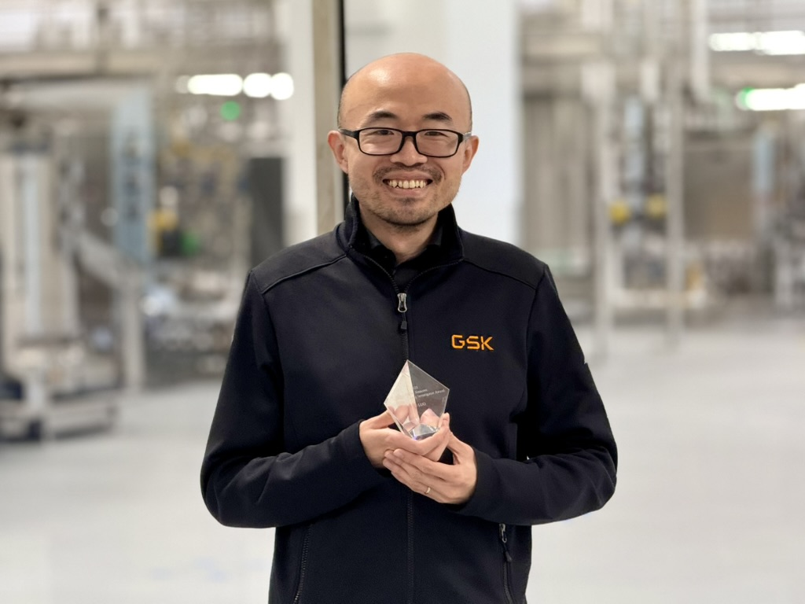
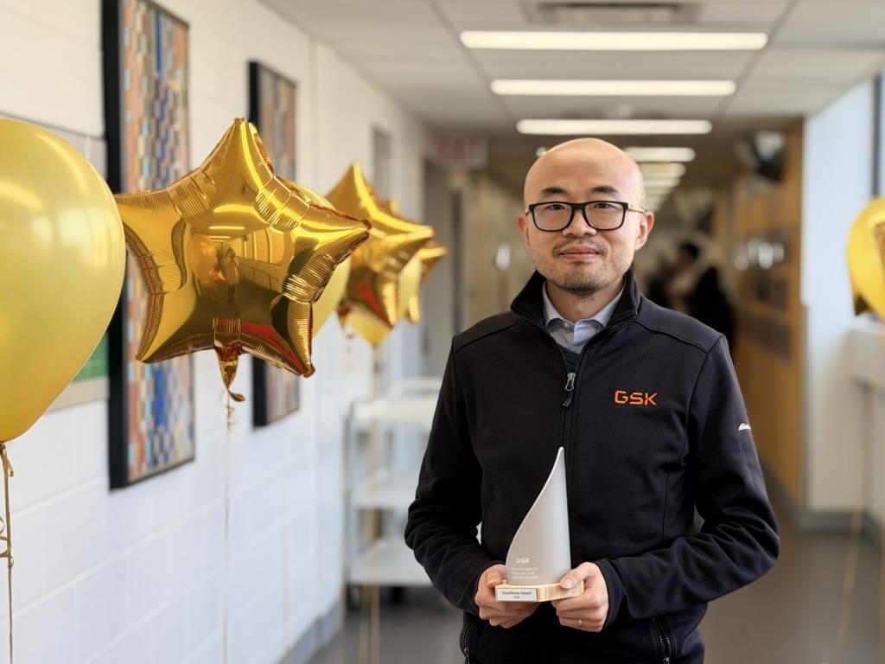

### Updates

|Date|News|
|:-|:-|
|2025-12-04|YL received the 2025 **Transformational Medicines and Vaccines Excellence Award**, which recognizes the achievements in model-based process development, monitoring, and control.|
|2025-03-05|YL received the 2025 [**Martin Sinacore Young Investigator Award**](https://engconf.us/conferences/biotechnology/cell-culture-engineering-xix/#header1) and was invited to give an award lecture titled Stories of Growth in Model-Based Process Development, Monitoring, and Control at [Cell Culture Engineering XIX](https://ssl.linklings.net/conferences/CCE/25acccexix_program/views/at_a_glance.html) in Tucson, Arizona.|
|2023-11-01|YL was promoted to Principal Investigator (Senior Principal Scientist) at GSK.|
|2021-02-01|YL joined GSK (Investigator, Biopharm Chemometrics and Process Modeling Expert).|
|2020-10-30|YL was invited to give a webinar at GSK.|
|2020-01-30|YL was invited to give a seminar at Purdue University in West Lafayette, IN.|
|2020-01-16|YL was invited to give a seminar at Clemson University in Clemson, SC.|
|2019-06-25|YL was invited to give a seminar at Imperial College London in the U.K.|
|2019-06-04|YL was invited to give a seminar at Clarkson University in Potsdam, NY.|
|2019-03-28|YL was invited to give a seminar at Stevens Institute of Technology in Hoboken, NJ.|
|2019-03-15|YL was invited to give a seminar at the University of Waterloo in Canada.|

### Year in Review

**2025** was a year of steady growth and meaningful milestones in my professional journey. I had the opportunity to reconnect with the bioprocess community through the Advanced Mammalian Biomanufacturing Innovation Center (AMBIC) and the Cell Culture Engineering (CCE) conference. I was honored to receive the Martin Sinacore Young Investigator Award at CCE and to deliver the award lecture remotely—an experience that underscored the collective nature of the work and the mentors, collaborators, and teams who have shaped my path. Within GSK, I continued to focus on translating modeling, model predictive control, and data-driven methods into practical process improvements. The year also brought unexpected recognition through the Transformational Medicines and Vaccines Excellence Award, along with continued opportunities to mentor colleagues.

| Martin Sinacore Young Investigator Award | Transformational Medicines and Vaccines Excellence Award |
| :--------------------: | :--------------------: |
|  |  |